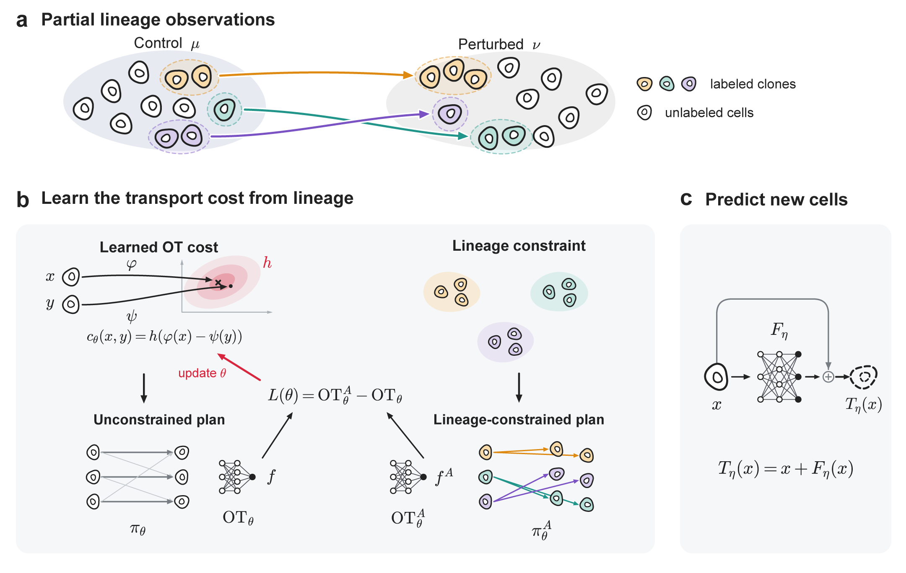

# CloneOT: predicting clone-specific perturbation responses with lineage-supervised neural inverse optimal transport

[](https://poseidonchan.github.io/CloneOT/)




Single-cell perturbation experiments measure two unpaired populations, cells before and cells after the perturbation.
Optimal transport (OT) methods such as CellOT predict the response of a cell by transporting it at minimal cost, but the
cost, usually the squared Euclidean distance, is fixed in advance and may connect cells with the wrong responses.
Lineage tracing links the cells of the same clone before and after the perturbation. **CloneOT** uses these links to
learn the transport cost itself, and a neural map then predicts the response of any new cell from its expression alone.

**Highlights**

- Learns a neural transport cost $c(x,y)=h(\varphi(x)-\psi(y))$ (neural ODE flows and a symmetric input convex network)
  from partially lineage-traced single-cell data, by minimizing the extra cost that the lineage forces on the optimal
  transport.
- Uses lineage only for training: new cells and clones that were never labeled are predicted from their expression.
- Works on AnnData: gene selection, VAE representation, cost learning, prediction and clone-level evaluation in a few
  lines.
- Trains one model in about 1.6 minutes on a single GPU.

## Installation

Install [PyTorch](https://pytorch.org) for your platform first, then

```bash
pip install git+https://github.com/poseidonchan/CloneOT.git
```

or, to run the tests and build the documentation,

```bash
git clone https://github.com/poseidonchan/CloneOT.git
cd CloneOT
pip install -e ".[test,docs]"
pytest
```

## Quick start

Your AnnData object needs a column with the condition of every cell and a column with the clone of every
lineage-traced cell (`NaN` for cells without a lineage label). Raw counts or log-normalized expression both work.

```python
import cloneot as cot

model = cot.CloneOTModel(
    adata,
    condition_key="condition",   # column of adata.obs with the condition of every cell
    source="control",            # cells before the perturbation
    target="treated",            # cells after the perturbation
    clone_key="clone",           # clone of every lineage-traced cell, NaN otherwise
)
model.train()                    # genes, VAE representation, transport cost and neural map

predicted = model.predict(new_cells)        # AnnData: predicted expression of every source cell
observed = model.observed(new_cells)        # AnnData: observed target cells
scores, r = cot.metrics.evaluate(predicted, observed, clone_key="clone", genes=model.response_genes(50))
```

`scores` holds the clone-level $\ell_2$, $r^2$ and energy score of every clone, and `r` is the clone-specific
correlation, which measures how well the predictions capture the differences between clones.

The solver also works on any arrays of cell states:

```python
from cloneot import CloneOT

model = CloneOT().fit(source, target, source_clones, target_clones)   # -1 or None for unlabeled cells
model.fit_map()
prediction = model.transport(new_source)
```

Without clone labels, CloneOT is entropic optimal transport with the squared Euclidean cost, the solver underlying
CellOT.

## Tutorials

| Tutorial | Content |
|---|---|
| [2D datasets](docs/tutorials/simulations.ipynb) | The T-shape and rotated-moons datasets of the paper, on which the squared Euclidean cost transports points to the wrong class. |
| [Lineage tracing of persister cells](docs/tutorials/watermelon.ipynb) | The full AnnData workflow on the Watermelon study (downloaded from GEO): training, prediction of seen and unseen clones, clone-level evaluation, saving and loading. |

## Documentation

The documentation, with installation, quick start, method, tutorials and API reference, is at
**https://poseidonchan.github.io/CloneOT/**. To build it locally,

```bash
pip install -e ".[docs]"
sphinx-build docs docs/_build/html
```

## Reproducing the paper

The [`experiments/`](experiments) folder contains the scripts of the 2D datasets of the paper (neural W2OT, OT-SI and
CloneOT on the T-shape and rotated-moons datasets). See [`experiments/README.md`](experiments/README.md).

## Contact

Questions and issues are welcome on [GitHub](https://github.com/poseidonchan/CloneOT/issues) or by email to
cys@umd.edu.
